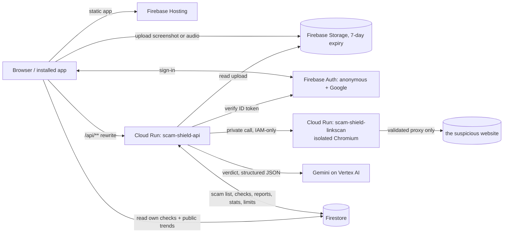

# Scam Shield

**Check a suspicious message, screenshot, QR code, link or voice note before you act on it.** Built for people in India, in English and Hindi (Hinglish understood).

- **Live app:** https://project-91260b43-6705-4176-b71.web.app
- **Demo video:** _add link before submitting_
- **Fictional demo bank page (used by the examples):** https://bnb-kyc-update.web.app

Built for the AI Builder Cup, track *BFSI: Intelligent Risk, Fraud & Financial Experiences*, on **Gemini on Vertex AI, Firestore, Firebase (Auth, Hosting, Storage) and Cloud Run**.

## What it does

You paste or share something suspicious. Scam Shield returns:

- a verdict: **Scam**, **Suspicious** or **No scam signs found** (it never says "safe"), with a risk score and scam type;
- the red flags, each tied to evidence quoted from your input, and what to do next;
- for scams: a **complaint draft** for 1930 / cybercrime.gov.in, a one-tap way to add the scammer's phone number, UPI ID or website to a **shared scam list** ("Reported N times", linked identifiers), and a **warning card** to share on WhatsApp.

It analyses the content itself, so it can catch a scam nobody has reported yet, and it understands UPI-specific inputs:

| Input | What happens |
|---|---|
| Text (SMS, WhatsApp, email) | Gemini reads it; phone numbers, UPI IDs and domains are looked up in the shared scam list |
| Screenshot | Gemini reads the image (for example a fake "payment successful" receipt with an impossible date) |
| QR code | Decoded on the server; a QR that asks you to **pay** while the text says you will **receive** is a hard scam signal |
| Link | Opened in an isolated, private browser service; the final address, redirects, page text and a screenshot are shown, never opened on your phone |
| Voice note | Gemini transcribes (Hindi, English, Hinglish) and analyses it, for example a "digital arrest" call |

Also: public **Trends** page, per-person **History**, one-click **examples** for first-time visitors, an installable app that appears in Android's **share menu**, and **WebMCP** tools (`check_message`, `report_scam`) for in-browser AI agents.

## How Google services are used

- **Gemini on Vertex AI** (`gemini-3.7-flash`, with `gemini-2.5-flash` as an automatic fallback): one multimodal call per check returns a schema-validated verdict (structured JSON output) for text, images and audio, including audio transcription and the link-scan screenshot. Hard signals from our own checks can only raise a verdict, never lower it. If the first attempt is slow or rate-limited, the retry goes to the fallback model, which has its own quota. Google Search grounding is built in but switched off by default (see `GEMINI_SEARCH`) because of project quota.
- **Cloud Run:** `scam-shield-api` (public API, Hono on Node) and `scam-shield-linkscan` (a private Playwright/Chromium service that opens suspicious links in isolation, with a validating proxy, DNS pinning and its own zero-role service account).
- **Firestore:** `checks` (a person's own results), `entities` (the shared scam list: phones, UPI IDs, domains, accounts, with report counts and links between identifiers), `reports`, `stats` (public daily trend counters) and `usage` (per-user and global daily limits). Clients can read only their own checks and the public stats; everything else is server-only.
- **Firebase:** Authentication (anonymous for checks, Google sign-in to report), Hosting (the web app and the `/api/**` rewrite to Cloud Run, plus the demo-bank site), Storage (uploads, deleted automatically after 7 days).

## Architecture



One check: the app sends the text or an uploaded file path to the API. The API verifies the user, applies per-user, per-IP and global limits, extracts phone numbers, UPI IDs, links and QR content, looks identifiers up in the scam list, scans any link in the isolated service, then asks Gemini for the verdict. Scam-list hits and QR-pay-versus-receive mismatches can raise the verdict. Text is stripped of OTPs, card and Aadhaar numbers before it is stored.

## Evaluation

50 synthetic cases (26 scams covering all 13 scam types, including Hinglish text, a fake receipt, a QR trick and a voice note; 24 genuine messages such as bank alerts, OTPs that say "do not share", delivery updates and a real payment receipt), run one at a time against the live app:

| Metric | Result |
|---|---|
| Accuracy | 100.0% (50 of 50 verdicts correct) |
| Scam recall (scams flagged) | 100% (26 of 26) |
| False-positive rate (genuine flagged) | 0.0% (0 of 24) |
| Scam type correct (among flagged scams) | 96.2% (25 of 26; one QR scam was labelled "fake payment") |
| Latency, text | p50 4.5 s, p95 12.9 s |
| Latency, image / audio | p50 8.9 s / 14.2 s (image p95 9.5 s) |

Details, cases and raw results: [`eval/`](eval/) and [`eval/results/latest.md`](eval/results/latest.md). The first run exposed a real bug (the model did not know today's date and flagged 2026 dates as "in the future"); it is fixed and the earlier result is kept in `eval/results/run1-before-date-fix.md`. The cases are synthetic and small, so treat the numbers as a sanity check, not a guarantee. An earlier run on `gemini-3.8-flash` scored 98.0% accuracy, 100% recall and 4.2% false positives, with image checks up to 34 s (kept in `eval/results/run-gemini-3.8-flash.md`); that model was slow and sometimes rate-limited on this project, so the default is now `gemini-3.7-flash` with a fallback. With only 50 cases the difference between 98% and 100% is a single case.

## Privacy and safety

- Guidance only: every result says so and points to **1930** and cybercrime.gov.in. "No scam signs found" is never a promise.
- Uploads auto-delete after 7 days. OTPs, card and Aadhaar numbers are blanked before any text is stored. Reports on the scam list carry no name, email or account.
- Scam-list wording is "Reported N times", never "confirmed scammer". A single report cannot make a scam verdict on its own.
- Link scanning is isolated and private: every request and redirect hop goes through a validating proxy that blocks private and internal addresses; the scanner has no cloud permissions. See [`linkscan/SECURITY.md`](linkscan/SECURITY.md).
- All names, numbers and IDs in examples and tests are fictional ("Bharat National Bank").

## Repository layout

| Path | What |
|---|---|
| `web/` | React 18 + Vite + Tailwind PWA (Firebase Hosting) |
| `api/` | Hono API on Cloud Run: extraction, redaction, QR decode, Gemini, scam-list store |
| `linkscan/` | Isolated Playwright link scanner on Cloud Run |
| `shared/` | Types, schema, masking and complaint template used by web and api |
| `eval/` | 50-case benchmark and results |
| `scripts/` | Deploy, smoke test, example-asset generators, seed data, screenshots |
| `docs/` | Design, plan, setup notes, submission material, screenshots |

## Run it yourself

```bash
npm install
npm test                 # all workspaces
npm run typecheck
npm run build -w web
```

Deploying needs the Google Cloud and Firebase CLIs and access to the project:

```bash
bash scripts/deploy.sh all     # rules, linkscan, api, web
bash scripts/smoke.sh https://project-91260b43-6705-4176-b71.web.app
npx tsx eval/run.ts            # the benchmark (sequential, paced)
```

Important settings (API environment): `GEMINI_MODEL`, `GEMINI_FALLBACK_MODEL`, `GEMINI_LOCATION`, `GEMINI_THINKING_LEVEL` (default LOW), `GEMINI_SEARCH` (default off), `TRUSTED_PROXY_HOPS` (2 behind Firebase Hosting), `LINKSCAN_URL`, `STORAGE_BUCKET`.

## Known limits

- English and Hindi only; no native app or SMS interception.
- Gemini latency varies (typically 4 to 20 s); on this project Google Search grounding hit quota limits, so it is off by default.
- The shared scam list is only as good as its reports; demo data is included for the examples (see the note on the Trends page).
