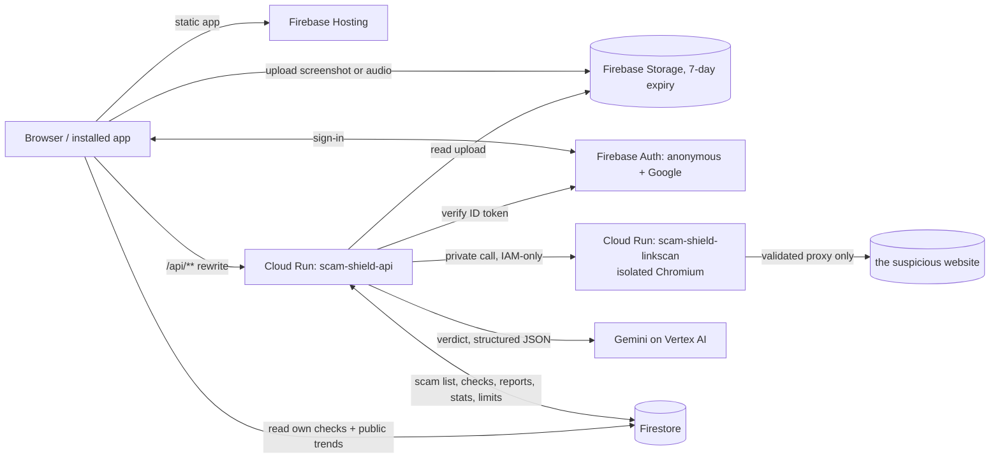
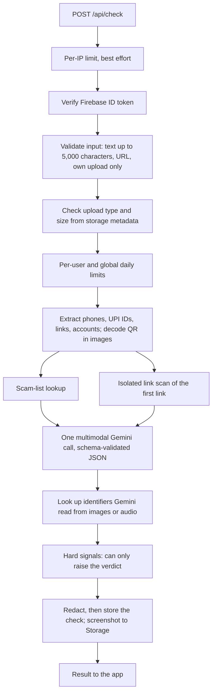

# Scam Shield architecture (for judges)

A person pastes a message, or adds a screenshot, QR code, link or voice note. One API call returns a verdict (Scam, Suspicious or No scam signs found), the red flags with quoted evidence, and next steps. This page explains what happens in that call, where the trust boundaries are, what Gemini does that rules cannot, how we evaluated it, what it costs, and what it does not do. Every statement here was checked against the code in `api/src`, `linkscan/src`, `firestore.rules` and `storage.rules`.

## The system

The 7-day expiry applies to the `uploads/` folder only; see "Known limits" for what else is stored.

## One check, step by step

1. **Limits and identity.** A best-effort per-IP limit (60 checks per minute, in memory per instance) runs first. Then the Firebase ID token is verified (anonymous users can check; Google sign-in is needed only to report). A text is capped at 5,000 characters and the request body at 32 KB.
2. **Uploads.** A screenshot or voice note goes from the browser straight to Storage under `uploads/{user id}/`. The API accepts only a path inside the caller's own folder, reads the object's own metadata (type and size, never the client's claim) and rejects wrong types or sizes before spending any quota or downloading it. Images up to 10 MB, audio up to 15 MB.
3. **Daily limits.** 30 checks per user per day and 3,000 per day overall, counted in Firestore transactions. The global counter only moves while the user is within their own limit.
4. **Extraction.** Plain code pulls phone numbers, UPI IDs, links, domains and bank account numbers out of the text, and decodes a QR code in an uploaded image (a UPI payment QR is parsed into payee, amount and note).
5. **Scam-list lookup and link scan run in parallel.** Each identifier is looked up in the shared scam list. The first link (typed, in the text, or inside a QR) is sent to the private link scanner, which returns the final address, redirects, page text, and a screenshot.
6. **One Gemini call.** A single request to Gemini on Vertex AI carries the instructions, the user's text, any uploaded image or audio, the decoded QR, the scam-list hits, the link-scan result and its screenshot, and today's date in India. The response must be JSON matching a schema (verdict, risk score, scam type, summary, red flags each with quoted evidence, next steps, extracted identifiers, language, and a transcript for audio) and is validated again with Zod; anything else is treated as a failure. The first attempt is cut off at 15 seconds; if the failure looks transient, one retry goes to a fallback model (`gemini-2.5-flash`), with a 40-second ceiling for the whole analysis and 45 seconds for the whole check. A failure returns an error, never a guessed verdict.
7. **Hard signals can only raise.** After the model answers, identifiers it read from images or audio are looked up too. Then deterministic rules apply: an identifier reported by two or more people makes the verdict Scam (score at least 85); one report makes it at least Suspicious (at least 60); a UPI "pay" QR while the text or transcript talks about receiving money, a refund, a prize or cashback makes it Scam (at least 85). These rules never lower a verdict. When they raise a verdict the model had called "no scam signs", the model's summary is replaced by a fixed sentence so the text does not contradict the verdict.
8. **Store with redaction.** The check is saved to Firestore with OTP, CVV and PIN numbers, card numbers, Aadhaar and PAN replaced by placeholders in the text, summary, flags, transcript, QR payload and page text; the scammer's own identifiers stay readable. The model's raw entity list is not stored, only identifiers that passed the extractor's checks. The link-scan screenshot is saved to Storage and only its path is kept.

## Trust boundaries

- **Untrusted content in the prompt.** The user's text, the scanned page's text and the QR payload are placed inside `<<<UNTRUSTED_... >>>` blocks, with length caps and look-alike delimiters neutralised. The instructions tell the model that these blocks, and anything read from an image or heard in audio, are data written by a third party; that instructions inside them must be ignored; and that an attempt to manipulate it is itself a red flag. This reduces prompt injection; it does not make it impossible (see Known limits).
- **The model cannot take actions.** Its output is a schema-validated verdict and nothing else. It cannot call tools, write to the scam list or reach the network.
- **Link scanner.** The Cloud Run service is private (no unauthenticated access; only the API's service account may invoke it) and runs as a service account with no roles and no VPC connector. Every connection, including each redirect hop and every sub-resource, goes through a per-scan validating proxy that resolves the name itself, accepts only public addresses on ports 80 and 443, and connects to exactly the addresses it validated (DNS pinning). Each scan uses a fresh browser context with a 15-second deadline, a 25 MB total cap and a 150-request cap, with WebRTC disabled and downloads, popups and permissions refused. Details and residual risks: [`linkscan/SECURITY.md`](../linkscan/SECURITY.md).
- **Firestore rules.** Clients may read a `checks` document only if its `uid` is theirs, and may read the public `stats` documents (daily counters and a list of recently reported identifiers, masked). Everything else is denied to clients, including the scam list itself, the record of who reported what, reports and usage counters. All writes go through the API with the Admin SDK.
- **Storage rules.** A signed-in user can create files only under `uploads/{their id}/`, only images up to 10 MB or audio up to 15 MB, and can read or delete only their own. Link-scan screenshots are written by the API; the owner can read them. All other paths are denied to clients.
- **Reports.** Reporting needs Google sign-in and a check the user owns, and needs the verdict to be Scam or Suspicious. The report record carries the check id, identifiers, scam type and an optional state and city, and no user id; a separate server-only record of which user already reported an identifier stops one person counting twice. The public list shows masked identifiers and counts ("Reported N times"), never wording like "confirmed scammer".

## What Gemini does that rules cannot

Our code can look up an identifier and spot a pay QR next to the word "receive". It cannot read a payment screenshot and notice that the date (31 September) does not exist, that a transaction reference has the wrong length, or that the sender name does not match the UPI ID. It cannot transcribe a Hinglish voice note and recognise a "digital arrest" threat and a fee demand. It cannot tell a genuine bank alert ("do not share your OTP") from a lookalike that asks you to act, judge urgency and pressure across English, Hindi and Hinglish, or compare a page's screenshot and text with the brand it claims to be. And it explains each flag with the exact words from the input, in the user's language. That is also why it can flag a scam nobody has reported yet. The deterministic checks are only a safety net around it.

## Evaluation method

- 185 synthetic cases written by the authors, in three sets: v1 (50 cases: 26 scams covering all 13 scam types, including Hinglish text, a fake receipt, a QR trick and a voice note, and 24 genuine messages such as bank alerts, OTP messages that say "do not share", delivery updates and a real payment receipt; 45 text, 4 images, 1 audio), v2 (35 harder cases: 14 adversarial scams, 16 look-alike genuine messages, 5 ambiguous inputs) and v3 (100 cases: 50 realistic scams over all 13 types and 50 realistic genuine messages). In total 90 scams, 90 genuine and 5 ambiguous inputs, which are not scored as scam or genuine.
- Each case is sent one at a time (sequential, paced to the API limits, with a fresh anonymous user for every 25 cases) to the live deployed app through Firebase Hosting, so the result covers the whole pipeline and not only the model. A message counts as flagged if the verdict is Scam or Suspicious. Run with `npx tsx eval/run.ts` (for example `--cases cases-v3.jsonl --gap 2500 --out run-v3`); results, raw files and the harness are in [`eval/`](../eval/).
- Headline, combined over the three live runs (`eval/results/combined.md`, `gemini-3.7-flash`): accuracy 98.3% (177 of 180), scam recall 100% (90 of 90), false-positive rate 3.3% (3 of 90), scam type correct 96.7% among flagged scams; text latency p50 4.5 s, p95 18.2 s; 0 errors; none of the 5 ambiguous inputs got a Scam verdict. Per run: v1 100/100/0, v2 33 of 35 correct with 2 false positives, v3 99 of 100 with 1 false positive. The three false positives are a scam-awareness forward quoting a scam link, a courier update with a tracking link, and a friend asking to borrow Rs 3,000. The combined report and the landing page numbers are generated by `npx tsx eval/aggregate.ts` from `eval/results/official.json`. The first 50-case run (`eval/results/latest.md`, 100/100/0) and the same 50 cases in Hindi (`eval/results/run-hindi.md`) remain valid history for those cases only. A keyword-only baseline scored the same 94.1% as Gemini on v2 text, and 84.0% accuracy / 72.0% recall on v3 text.
- Honest limits: all cases are synthetic, written by us, and few are images or audio. A few cases (the demo examples, such as the fake KYC message and the QR case) contain identifiers that are also seeded in the demo scam list, so those are partly list-assisted. The first run exposed a real bug (the model flagged 2026 dates as "in the future"), and we tuned the prompt and settings while working with the v1 cases, so v1 is not a held-out test (the v2 and v3 run reports state that nothing was tuned after seeing their results). It is a sanity check, not a guarantee, and each run is a single pass without confidence intervals; with 180 scored cases one case is about 0.6 percentage points.

## Cost and scaling

The figures below are estimates from Google's published prices on 18 Oct 2026, with the arithmetic and assumptions in the speaker notes of deck slide 10 and in [`docs/submission/deck-outline.md`](submission/deck-outline.md). None is a measured bill.

- **Fixed:** about US$13 per month for one Cloud Run API instance kept warm (1 vCPU, 1 GiB).
- **Per check:** about US$0.004 to 0.008 for a text check on Gemini 3.7 Flash, assuming about 2,500 input tokens and 500 to 1,500 output tokens; image and audio checks use more input.
- **Everything else:** Firebase Hosting, Auth, Firestore and Storage are expected to stay in free tiers at this volume; the link scanner bills only while scanning and scales to zero.
- **Bounds:** 30 checks per user per day, 60 per IP per minute and 3,000 per day overall (about US$11 to 23 per day for Gemini at the cap), plus a budget alert of Rs 1,000 per month at 50%, 90% and 100%.
- **Scaling:** the API is stateless on Cloud Run (concurrency 20, 1 to 5 instances today); the link scanner runs 0 to 3 instances, 4 scans at a time each. Firestore, Hosting, Auth and Storage are managed. Raising the cap or the instance limit is a configuration change.

## Known limits

- **Accuracy.** Gemini can be wrong in both directions. "No scam signs found" means only that nothing was found in what we were shown, never a promise. The benchmark is small, synthetic and authored by us (see above).
- **Prompt injection.** Delimiting untrusted text and telling the model to ignore instructions in it lowers the risk but cannot remove it, and a successful injection could talk a verdict down. Hard signals only raise verdicts, and the model has no tools, but there is no separate second check on the model's answer.
- **Privacy.** Text and uploaded files are sent to Gemini before redaction; redaction happens before the check is stored. It is pattern-based (OTP, CVV and PIN numbers near their labels, Luhn-valid card numbers, Aadhaar, PAN) and can miss things. Uploaded images and audio are stored as uploaded, without redaction, until the 7-day lifecycle rule deletes them. That rule covers only the `uploads/` folder. A copy of the file is kept under `reports/` when the user reports a scam, and link-scan screenshots are kept under `screenshots/`; neither is deleted by that rule. Check records in Firestore (redacted text, result) have no automatic expiry configured in this repository.
- **Link checks.** Only the first link in an input is scanned, and a scan can fail or be blocked (the result then says so, and the model is told to judge the link from its address alone). Google Search grounding exists in the code but is off by default because of quota errors on this project, and there is no URL reputation feed, so a link is judged from the model's own knowledge plus the scan.
- **Abuse limits.** The per-IP limit is best effort (in memory per instance, fails open when full, keyed on a header a caller who reaches the Cloud Run address directly can partly control). The real guards are the per-user and global daily limits, but anonymous accounts are free to create, so the per-user limit is soft; there is no Firebase App Check yet.
- **Scam list.** It starts with fictional demo data (labelled as such on the Trends page), it has no moderation step, and an identifier counts once per Google account. Two reports are enough to make an identifier a Scam hard signal, so a determined person with several Google accounts could abuse it.
- **Scope and speed.** English and Hindi only; no native app or SMS interception. A check usually takes 4 to 21 seconds, with a hard limit of 45 seconds, after which the app shows an error instead of a verdict.
